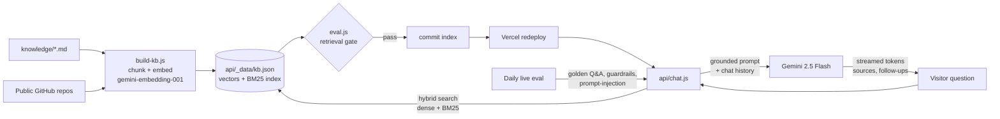

# Mayur Dokras - Portfolio + MACK

Portfolio site (GitHub Pages) with **MACK**, a retrieval-augmented AI career assistant (Vercel serverless + Google Gemini), kept up to date by an MLOps pipeline on GitHub Actions.

## How MACK works



| Capability | Where |
|---|---|
| Hybrid retrieval (Gemini embeddings + BM25, synonym expansion) | `api/_lib/rag.js` |
| Grounded answers, multi-turn memory, streaming (NDJSON), source citations, follow-up questions | `api/chat.js` |
| **Job-description matcher** - paste a JD, get a fit score, matches, gaps and a recruiter pitch (structured JSON output) | `api/chat.js` + chat UI |
| Voice input (speech recognition) and read-aloud answers | `script.js` |
| Knowledge base build with embedding cache (only changed chunks are re-embedded) and GitHub repo ingestion | `scripts/build-kb.js` |
| Golden-set evals: retrieval hit@1 / hit@3 / MRR, live answer grading, guardrail and prompt-injection probes | `scripts/eval.js`, `evals/golden.json` |
| Eval badge shown in the chat window | `evals/latest.json` |

## Workflows

- **MACK · rebuild knowledge** (`.github/workflows/mack-knowledge.yml`) - on every change to `knowledge/`, every Monday, or on demand: rebuilds the index, runs the retrieval eval as a quality gate, and commits `kb.json` + `evals/latest.json`. Vercel redeploys the API automatically.
- **MACK · evals** (`.github/workflows/mack-evals.yml`) - on pull requests: offline retrieval eval, so a bad knowledge edit can't merge. Daily: asks the live API the golden questions and fails (GitHub emails you) if answer quality or uptime drops.

## Setup

1. **GitHub secret** - repo *Settings → Secrets and variables → Actions → New repository secret*: `GEMINI_API_KEY` (same key as on Vercel).
2. **Vercel** - keep `GEMINI_API_KEY` in the project's environment variables. Optional: `MACK_MODEL` to switch the chat model.
3. **First build** - *Actions → MACK · rebuild knowledge → Run workflow*. This adds embeddings (the committed index starts as keyword-only).
4. *(Optional)* If the API URL changes, add a repository **variable** `MACK_URL`.

## Teaching MACK something new

Edit or add a Markdown file in `knowledge/`, using `## Section` headings, and push. Optional front matter adds suggested follow-up questions:

```markdown
---
title: GenAI Projects
questions:
  - Tell me about SotonBuddy
---
## SotonBuddy - LoRA fine-tuned campus assistant
...
```

Add a test case for it in `evals/golden.json` so CI guards it.

## Local commands

```bash
npm run kb          # build knowledge base (set GEMINI_API_KEY for embeddings)
npm run eval        # retrieval eval
npm run eval:live   # + grade answers from the deployed API
```
